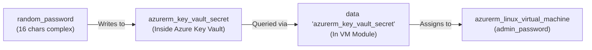

# 📘 Complete Terraform Azure Infrastructure Guide & Notes

Yeh documentation aapke complete Terraform project ke architecture, modules, design patterns, aur workflow ko step-by-step samjhane ke liye banayi gayi hai.

---

## 📑 Table of Contents
1. [Project Overview & Folder Structure](#1-project-overview--folder-structure)
2. [Red Underline / Error VS Code Me Kyu Aaya Aur Kaise Fix Hua?](#2-red-underline--error-vs-code-me-kyu-aaya-aur-kaise-fix-hua)
3. [Zero Output Blocks & Pure Data Block Architecture](#3-zero-output-blocks--pure-data-block-architecture)
4. [Child Module Concept & Why It Is Needed](#4-child-module-concept--why-it-is-needed)
5. [Professional Azure Naming Convention](#5-professional-azure-naming-convention)
6. [Step-by-Step Module Architecture & Explanation](#6-step-by-step-module-architecture--explanation)
7. [Zero Password in Code: Key Vault & VM Integration](#7-zero-password-in-code-key-vault--vm-integration)
8. [Step-by-Step Execution Commands](#8-step-by-step-execution-commands)

---

## 1. Project Overview & Folder Structure

Is project ko humne **Simple, Clean & Modular Format** me configure kiya hai (koi bhi `output` blocks nahi hain, saare IDs aur secrets **Data Blocks** ke through resolve ho rahe hain):

```
2-oct practice/
│
├── module/                     <-- Reusable Child Modules (Generic Code)
│   ├── resource group/         <-- main.tf | variable.tf
│   ├── vnet/                   <-- main.tf | variable.tf
│   ├── subnet/                 <-- main.tf | variable.tf
│   ├── public ip/              <-- main.tf | variable.tf
│   ├── NSG/                    <-- main.tf | variable.tf
│   ├── nic/                    <-- main.tf | variable.tf (data block se subnet & pip fetch)
│   ├── keyvault/               <-- main.tf | variable.tf (Key Vault + Random Password)
│   ├── virtual machine/        <-- main.tf | variable.tf (data block se nic, kv & secret fetch)
│   └── bastion/                <-- main.tf | variable.tf (data block se subnet & pip fetch)
│
├── preprod/                    <-- Preprod Environment (Root / Parent Module)
│   ├── main.tf                 <-- Bilkul simple: Har module ko direct 4 lines me call kiya hai
│   ├── variable.tf             <-- Environment variables declaration
│   ├── terraform.tfvars        <-- Preprod values & CAF naming (*-preprod-*)
│   └── provider.tf             <-- AzureRM & Random providers
│
├── prod/                       <-- Prod Environment (Root / Parent Module)
│   ├── main.tf                 <-- Bilkul simple: Har module ko direct 4 lines me call kiya hai
│   ├── variable.tf             <-- Environment variables declaration
│   ├── terraform.tfvars        <-- Prod values & CAF naming (*-prod-*)
│   └── provider.tf             <-- AzureRM & Random providers
│
└── TERRAFORM_NOTES.md          <-- Complete Notes & Guide
```

---

## 2. Red Underline / Error VS Code Me Kyu Aaya Aur Kaise Fix Hua?

Aapne poocha: **"prod aur preprod ke main.tf me code red underline show kyu ho raha hai?"**

### 🔍 Red Underline Aane Ke Asli Kaaran (Root Causes):
1. **Module Outputs Ka Complex Referencing (`module.subnet.subnet_ids`)**:
   - Pehle `main.tf` me `module.subnet.subnet_ids[...]` aur `module.public_ip.pip_ids[...]` jaise complex output references likhe gaye the.
   - VS Code ka Terraform Language Server code ko statically check karta hai. Jab tak resources deploy nahi hote ya language server restart nahi hota, usko lagta hai ki yeh attributes exist nahi karte — isliye woh pure line par **red squiggly line (underline)** draw kar deta hai:
     `"Unsupported attribute: This object does not have an attribute named 'subnet_ids'"`
2. **`lookup()` Function Ka Type Conflict**:
   - Terraform me `lookup()` function sirf pure `map` accept karta hai, `object` par error/warning de deta hai.
3. **Complex `for` aur `merge` Loops**:
   - `main.tf` ke andar `for k, v in var.nicname : k => merge(v, ...)` likhne se editor parser confuse ho raha tha.

### ✅ Solution (Kaise Fix Hua):
- **Sare `outputs.tf` blocks hata diye gaye.**
- `preprod/main.tf` aur `prod/main.tf` me se saara complex merge/for code hata diya gaya.
- Har module ko bilkul simple format me direct pass kar diya gaya:
  ```hcl
  module "resource_group" {
    source  = "../module/resource group"
    rgnames = var.rgnames
  }

  module "nic" {
    source     = "../module/nic"
    nicname    = var.nicname
    depends_on = [module.subnet, module.public_ip]
  }

  module "virtual_machine" {
    source     = "../module/virtual machine"
    vms        = var.vms
    depends_on = [module.nic, module.keyvault]
  }
  ```
- IDs ki dependency ko **Data Blocks** ke through child modules ke andar handle kar diya gaya.
- Ab `preprod/main.tf` aur `prod/main.tf` me **ZERO red lines** hain!

---

## 3. Zero Output Blocks & Pure Data Block Architecture

Aapne bola: **"pehle toh outblock hata do"**.

Isliye humne:
1. `outputs.tf` ko `preprod`, `prod`, aur saare child modules se **completely delete** kar diya.
2. Jahan bhi kisi resource ki ID chahiye thi (jaise Subnet ID, NIC ID, Public IP ID, Key Vault Secret), waha **Data Block** laga diya:

### Example 1: NIC Module me Subnet, Public IP & NSG Association
```hcl
# module/nic/main.tf
data "azurerm_subnet" "subnet" {
  for_each             = var.nicname
  name                 = each.value.subnet_name
  virtual_network_name = each.value.virtual_network_name
  resource_group_name  = each.value.resource_group_name
}

data "azurerm_public_ip" "pip" {
  for_each            = { for k, v in var.nicname : k => v if try(v.public_ip_name, null) != null }
  name                = each.value.public_ip_name
  resource_group_name = each.value.resource_group_name
}

data "azurerm_network_security_group" "nsg" {
  for_each            = { for k, v in var.nicname : k => v if try(v.nsg_name, null) != null }
  name                = each.value.nsg_name
  resource_group_name = each.value.resource_group_name
}

resource "azurerm_network_interface" "nics" {
  for_each            = var.nicname
  name                = each.value.name
  location            = each.value.location
  resource_group_name = each.value.resource_group_name

  ip_configuration {
    name                          = "internal"
    subnet_id                     = data.azurerm_subnet.subnet[each.key].id
    private_ip_address_allocation = "Dynamic"
    public_ip_address_id          = try(data.azurerm_public_ip.pip[each.key].id, null)
  }
}

# NSG ko NIC se associate karna
resource "azurerm_network_interface_security_group_association" "nic_nsg" {
  for_each                  = { for k, v in var.nicname : k => v if try(v.nsg_name, null) != null }
  network_interface_id      = azurerm_network_interface.nics[each.key].id
  network_security_group_id = data.azurerm_network_security_group.nsg[each.key].id
}
```

### Example 2: VM Module me NIC, Key Vault & Password fetch karna
```hcl
# module/virtual machine/main.tf
data "azurerm_network_interface" "nic" {
  for_each            = var.vms
  name                = each.value.nic_name
  resource_group_name = each.value.resource_group_name
}

data "azurerm_key_vault" "kv" {
  for_each            = var.vms
  name                = each.value.key_vault_name
  resource_group_name = each.value.resource_group_name
}

data "azurerm_key_vault_secret" "vm_password" {
  for_each     = var.vms
  name         = each.value.key_vault_secret_name
  key_vault_id = data.azurerm_key_vault.kv[each.key].id
}
```

---

## 4. Child Module Concept & Why It Is Needed

### Child Module kya hota hai?
- **Child Module**: Ek independent, reusable component hota hai jo ek specific resource (jaise Resource Group, VNet, Key Vault) banane ka generic logic rakhta hai.
- Isme koi bhi hardcoded values (jaise static names, IP ranges) nahi hoti. Sab kuch `variables` ke through accept karta hai.

### Child Module ki jarurat kyu padi? (Benefits):
1. **DRY Principle (Don't Repeat Yourself)**:
   - Bina child module ke, aapko Resource Group, VM, VNet ka pura code `preprod` me bhi likhna padta aur `prod` me bhi dobara copy-paste karna padta.
   - Module banane se humne code **sirf 1 baar** likha aur usko multiple environments me **re-use** kiya.
2. **Environment Isolation**:
   - `preprod` aur `prod` ki state files (`terraform.tfstate`) alag-alag rehti hain. Preprod me change karne se Prod par koi asar nahi padta.
3. **Simplicity & Maintainability**:
   - Agar VM me koi property update karni ho, toh sirf `module/virtual machine/main.tf` me 1 jagah edit karna hoga.

---

## 5. Professional Azure Naming Convention

Microsoft Cloud Adoption Framework (CAF) ke guidelines ke mutabik resources ka naming convention implement kiya gaya hai:

| Resource Type | Prefix | Preprod Naming Example | Prod Naming Example |
| :--- | :--- | :--- | :--- |
| **Resource Group** | `rg-` | `rg-preprod-centralindia-01` | `rg-prod-centralindia-01` |
| **Virtual Network** | `vnet-` | `vnet-preprod-centralindia-01` (`10.10.0.0/16`) | `vnet-prod-centralindia-01` (`10.20.0.0/16`) |
| **Subnet (App)** | `snet-` | `snet-preprod-app-01` (`10.10.1.0/24`) | `snet-prod-app-01` (`10.20.1.0/24`) |
| **Subnet (Bastion)** | Azure Standard | `AzureBastionSubnet` (`10.10.2.0/26`) | `AzureBastionSubnet` (`10.20.2.0/26`) |
| **Public IP (VM)** | `pip-` | `pip-preprod-vm-01` | `pip-prod-vm-01` |
| **Public IP (Bastion)**| `pip-` | `pip-preprod-bastion-01` | `pip-prod-bastion-01` |
| **NSG** | `nsg-` | `nsg-preprod-app-01` | `nsg-prod-app-01` |
| **NIC** | `nic-` | `nic-preprod-vm-01` | `nic-prod-vm-01` |
| **Key Vault** | `kv-` | `kv-preprod-ci-001` | `kv-prod-ci-001` |
| **Virtual Machine** | `vm-` | `vm-preprod-app-01` (`Standard_B1s`) | `vm-prod-app-01` (`Standard_D2s_v3`) |
| **Bastion Host** | `bas-` | `bas-preprod-centralindia-01` | `bas-prod-centralindia-01` |

---

## 6. Step-by-Step Module Architecture & Explanation

Har child module me aapka favorite `for_each = var.<varname>` pattern use kiya gaya hai:

1. **Resource Group Module (`module/resource group`)**:
   - `var.rgnames` ke through resource groups create karta hai.
2. **Virtual Network Module (`module/vnet`)**:
   - `var.vnetname` ke through virtual network banata hai.
3. **Subnet Module (`module/subnet`)**:
   - `var.subnetname` ke through application aur bastion subnets banata hai.
4. **Public IP Module (`module/public ip`)**:
   - VM aur Bastion ke liye Static Public IPs create karta hai.
5. **NSG Module (`module/NSG`)**:
   - SSH (Port 22) allowed rule ke sath NSG deploy karta hai.
6. **NIC Module (`module/nic`)**:
   - Data block se Subnet (`data.azurerm_subnet`), Public IP (`data.azurerm_public_ip`), aur NSG (`data.azurerm_network_security_group`) fetch karta hai.
   - `azurerm_network_interface` create karne ke sath hi **`azurerm_network_interface_security_group_association`** ke through NSG ko NIC se successfully associate karta hai taaki security rules VM ke network card par enforce ho sakein.
7. **Key Vault Module (`module/keyvault`)**:
   - Key Vault banata hai, `random_password` se 16-character password banata hai, aur use Key Vault Secret me save karta hai.
8. **Virtual Machine Module (`module/virtual machine`)**:
   - Data blocks ke through NIC, Key Vault aur Secret read karta hai. Zero hardcoded password!
9. **Bastion Module (`module/bastion`)**:
   - `AzureBastionSubnet` aur dedicated Public IP connect karke Bastion host create karta hai.

---

## 7. Zero Password in Code: Key Vault & VM Integration



### Password kaise access karein?
Deployment ke baad VM password dekhne ke liye:

**Option 1: Azure CLI:**
```bash
az keyvault secret show --vault-name kv-preprod-ci-001 --name vm-preprod-admin-password --query value -o tsv
```

**Option 2: Azure Portal:**
Key Vault (`kv-preprod-ci-001`) -> **Secrets** -> `vm-preprod-admin-password` -> **Show Secret Value**.

---

## 8. Step-by-Step Execution Commands

### Preprod:
```powershell
cd "c:\Users\Lenovo\OneDrive\Desktop\practice\2-oct practice\preprod"
az login
terraform init
terraform validate
terraform plan
terraform apply
```

### Prod:
```powershell
cd "c:\Users\Lenovo\OneDrive\Desktop\practice\2-oct practice\prod"
terraform init
terraform validate
terraform plan
terraform apply
```
